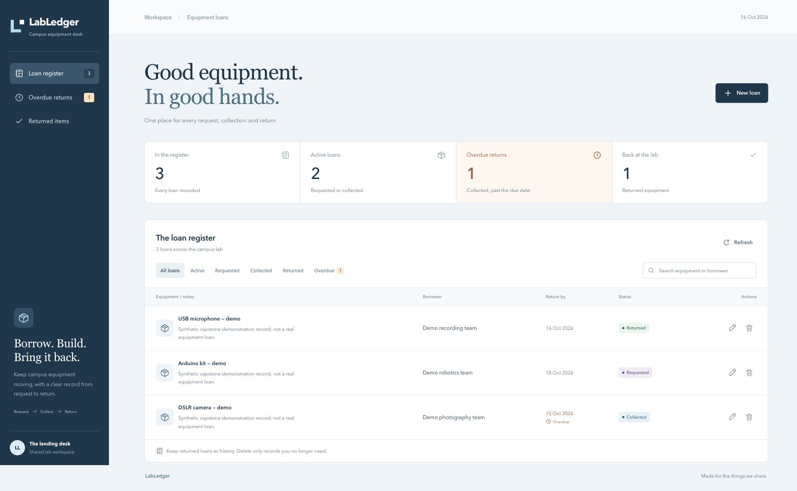

# LabLedger — Campus Equipment Loans

LabLedger is an original campus equipment-loan application. A lab desk records a borrowing request, marks collection, spots overdue equipment, records a return and removes obsolete demonstration records. It is a different application domain and interface from the course TaskBoard example.

**Student:** Jaivardhan D Rao · **Roll:** 10117 · **Enrollment:** 24BCS10117 · **Group:** A
**School account:** jaivardhan.24bcs10117@sst.scaler.com

The repository contains the application, tests, delivery workflow, infrastructure configuration and real local and temporary AWS evidence. [Rubric status](docs/RUBRIC-STATUS.md) records completed checks and remaining requirements.



The screenshot shows three explicitly fictional demonstration records. [SST-profile browser review](evidence/ui-monitoring-review.md) documents the responsive UI and capture provenance.

## Application and request flow

- React/Vite equipment ledger: responsive table/cards, search, status/overdue filters, create/edit dialogs, return and confirmed deletion, loading/error/empty states.
- FastAPI: collection/item GET, POST, PUT and DELETE, plus statistics, Swagger, liveness, database readiness and Prometheus metrics.
- PostgreSQL 17 with SQLAlchemy and Alembic. Migrations are serialized for Compose and owned by a migration Job in Kubernetes.
- A date has no timezone offset; overdue means a **collected** loan whose due date is before today in Asia/Kolkata. Requested loans count as active but are not overdue.

```text
Compose: browser :3000 → non-root Nginx :8080 → FastAPI :8000 → PostgreSQL
Kubernetes: Ingress → frontend/backend ClusterIP Services → two replicas each
                                              backend → PostgreSQL StatefulSet/PVC
Prometheus → /metrics → Grafana request/latency/error panels
```

Nginx and Ingress preserve `/api`; the browser never calls an internal Kubernetes or Compose hostname. Compose's proxy re-resolves Docker DNS when a backend is recreated. Kubernetes routes through a stable Service. The frontend image runs as 101; backend runs as 10001. Database passwords are generated outside Git and supplied by environment or an external Kubernetes Secret.

## Run the real local stack

Prerequisites: Docker with Compose, Python 3 and a running Docker engine. From the repository root:

```sh
python3 scripts/init-env.py
# If .env already exists, keep it; the generator refuses to overwrite credentials.
docker compose up --build -d --wait
python3 scripts/check-runtime.py
```

Open **http://localhost:3000** in the SST School Chrome profile. Swagger is **http://localhost:8000/docs**; operational endpoints are `/health`, `/ready` and `/metrics`. The runtime checker creates, reads, changes and removes one explicitly fictional test loan through the real frontend proxy.

This is an unauthenticated classroom demonstration, not a system for real student personal data. Included demonstration records explicitly identify themselves as fictional. No real equipment lending or personal experience is claimed.

```sh
docker compose ps
docker compose exec backend id
docker compose exec frontend id
docker compose stop
# stop keeps the database volume. Do not use down -v unless deliberately deleting demo data.
```

## Run isolated checks

```sh
python3.12 -m venv backend/.venv
backend/.venv/bin/python -m pip install -r backend/requirements-dev.txt
(cd backend && .venv/bin/python -m pytest -v && .venv/bin/ruff check app tests)
(cd frontend && npm ci && npm test && npm run build)
terraform -chdir=terraform init -backend=false
terraform -chdir=terraform validate
terraform -chdir=terraform test
python3 -m venv .local/validation-venv
.local/validation-venv/bin/python -m pip install -r scripts/requirements-validation.txt
PYTHON_BIN=.local/validation-venv/bin/python ./scripts/cluster-validate.sh
```

Backend tests use isolated SQLite/mocks rather than the running PostgreSQL database. A separate real-stack check validates the PostgreSQL/Compose path. Terraform tests use a **mock AWS provider** and do not access an account. The Helm validation script needs Python with PyYAML and Helm; see [Helm instructions](helm/README.md). Validation evidence is indexed under [evidence](evidence/README.md).

## Delivery and security gates

[The main workflow](.github/workflows/delivery.yml) runs API/migration tests, Python checks, frontend tests and a production build. Only after those jobs pass does it build and scan both application images for **amd64 and arm64**. Each image must pass Trivy with `--severity HIGH,CRITICAL --ignore-unfixed=false --exit-code 1` before publishing. After all four scans pass, a final job creates the two multi-architecture GHCR tags using the full commit SHA. No `latest` tag is promoted.

For `jaivardhandrao/labledger-devops-capstone`, the canonical image names are:

```text
ghcr.io/jaivardhandrao/labledger-devops-capstone-backend:<40-character-git-sha>
ghcr.io/jaivardhandrao/labledger-devops-capstone-frontend:<40-character-git-sha>
```

The workflow uses the repository-scoped ephemeral GitHub token for GHCR. It contains no AWS credentials or automatic AWS access grant. Publishing a repository or changing package visibility is a separate approval action. The [first actual green run](https://github.com/jaivardhandrao/labledger-devops-capstone/actions/runs/38908280610) passed both test jobs, all four strict image scans and multi-architecture publication for commit `7e28da8`. [Downloaded CI reports](evidence/ci/baseline-scan-summary.json) record the exact image IDs and zero HIGH/CRITICAL findings. Both promoted 06909ce SHA manifests were actually readable anonymously; see the [cloud evidence](evidence/aws-live-2026-10-16/README.md).

[Local promotion](scripts/promote-local.sh) requires clean tracked files and a successful main-push delivery run for the reviewed SHA. It builds/scans images and deploys chart inputs from an exact Git archive of that commit, preserves monitoring, loads the native images into the dedicated Minikube profile, and waits for rollout. This is an explicit promotion step; it does not claim that the publication workflow automatically deploys to AWS.

## Kubernetes and observability

The chart includes two frontend/two backend replicas, ClusterIP Services, Ingress, CPU requests, HPA 2–4, startup/readiness/liveness probes, a PostgreSQL PVC, an external Secret reference and a single migration Job. [Helm deployment instructions](helm/README.md) distinguish local images from SHA-tagged release images.

The dedicated local profile is **labledger-capstone**. Every command and script must select it explicitly; the older coursework context is preserved. The local override uses hostname **localhost**, so a loopback port-forward through the Ingress Controller can serve **http://localhost:8088** without editing hosts or buying a domain.

[Monitoring instructions](monitoring/README.md) describe the pinned Prometheus/Grafana chart, matching ServiceMonitor selectors and the [six-panel dashboard](monitoring/dashboards/labledger.json). The UIs remain authenticated/ClusterIP and are accessed through local port-forwards. A JSON dashboard is not evidence of a populated panel; the evidence index records actual scrape and traffic results separately.

## AWS infrastructure and permissions

[Terraform](terraform/README.md) defines two public/two private subnets, optional NAT, restricted EKS API access and one managed worker group, with CNI/EBS CSI service roles and encrypted storage. `terraform.tfvars.example` contains documentation placeholders. The provider requires an explicitly approved account ID and rejects another account.

**The personal AWS run is complete and verified removed.** The exact plan created 62 resources in Mumbai; EKS 1.34 and its managed t3.large group became ACTIVE. The app ran through its NLB with two Ready UI / two Ready API replicas, encrypted gp3, real CRUD, actual metrics and HPA 2 → 4 Ready → 2. [Actual evidence and retained failures](evidence/aws-live-2026-10-16/README.md) include the fresh seven-job green [06909ce run](https://github.com/jaivardhandrao/labledger-devops-capstone/actions/runs/38934060961) and exact-SHA EKS promotion.

After capture, the disposable PVC/EBS was deleted before its driver/node, then the reviewed 62-delete Terraform plan removed the infrastructure. [Post-removal API/state verification](evidence/aws-live-2026-10-16/cloud-cleanup-verification.json) confirms zero managed state, the exact cloud resources absent, new-only service-role cleanup and preservation of the existing default VPC. The verified lifecycle was 80.89 minutes, within the approved two-hour window. The temporary endpoint is retired. No workplace AWS profile was used. Actual final billing is not verified; the published price worksheet remains an estimate.

Browser Console/app/Prometheus originals remain private pending their specific publication approval. Native Terminal/API evidence is published separately. A populated Grafana browser panel and the full student live walkthrough are not claimed complete.

## Presentation, evidence and troubleshooting

[Watch or download the 58-second engineering overview](evidence/presentation/LabLedger_Engineering_Walkthrough.mp4). It combines actual recorded application, CI, EKS, monitoring and teardown evidence with explanatory animations and default macOS `say` narration. The temporary cloud environment has been removed. This edited overview supplements the [full demonstration requirements and remaining evidence](docs/RUBRIC-STATUS.md).

- [Rubric status and remaining evidence](docs/RUBRIC-STATUS.md)
- [Actual evidence index](evidence/README.md)
- [Demonstration and presentation guide](docs/DEMO.md)
- [Presentation PDF, editable slides and speaker notes](docs/presentation/README.md)
- [Genuine native Terminal screenshots and recording](evidence/presentation/README.md)
- [Actual commit-to-deployment demonstration record](docs/DELIVERY-DEMONSTRATION.md)
- [Troubleshooting record](troubleshooting/README.md)
- [Infrastructure validation limits](terraform/VALIDATION.md)
- [Submission sources and review checklist](docs/SUBMISSION-REVIEW.md)
- [AWS review-only inventory and pricing worksheet](docs/AWS-REVIEW-PLAN.md)
- [Guarded EKS bootstrap, real evidence and cleanup sequence](docs/CLOUD-BOOTSTRAP-RUNBOOK.md)

The final school form accepts one repository URL and no resubmission. Use the verified SST account, Group A and numeric roll 10117. Keep the final Submit action for the student after reviewing the repository URL and evidence. These instructions do not claim that a form has been filled or submitted.
